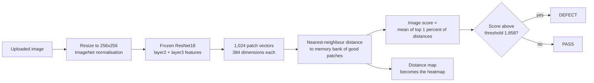

# AI-Powered Quality Inspection
 
**Unsupervised visual defect detection for electronics manufacturing, trained on good parts only.**
PatchCore on the MVTec AD transistor category catches **38 of 40 defects** (recall 0.950, F1 0.884) while flagging only **8 of 60 good parts**, served through a FastAPI backend and a React inspection dashboard.
 


 
**Status:** finished as a local demo (Phases 1-5). Cloud hosting was deliberately left out of scope; see [Deploying](#deploying).
 

 
---
 
## Why this project exists
 
A real production line makes thousands of good parts for every defective one, so there are almost no labelled defect examples to train a normal classifier on. This project takes the practical industrial route instead: **learn what a normal part looks like from good images only, then flag anything that deviates**, and show *where* it deviates.
 
It was built as four progressively stronger approaches, each evaluated the same way, followed by a working inspection service:
 
| Phase | What was built |
|---|---|
| 1 | Reusable PyTorch data pipeline for MVTec AD |
| 2 | Supervised ResNet18 baseline (to build and validate the train / evaluate pipeline) |
| 3 | Unsupervised convolutional autoencoder (reconstruction error as the anomaly score) |
| 4 | PatchCore (frozen pretrained features, memory bank, nearest-neighbour distance) |
| 5 | FastAPI inference service + React dashboard |
| 6 | Cloud packaging: Dockerfile and pinned dependencies prepared, not deployed (see [Deploying](#deploying)) |
 
---
 
## Results
 
Evaluated on the **official MVTec AD test split** (transistor): 60 good parts, 40 defective parts.
 
| Approach | Trained on | Precision | Recall | F1 | Good parts falsely flagged |
|---|---|---:|---:|---:|---:|
| Supervised ResNet18 (frozen backbone)<sup>1</sup> | 196 good + 29 defect (pooled split) | 0.278 | 0.625 | 0.385 | 13 / 55 (24%) |
| Convolutional autoencoder | 182 good | 0.477 | 0.525 | 0.500 | 23 / 60 (38%) |
| **PatchCore** | 182 good (memory bank) | **0.826** | **0.950** | **0.884** | **8 / 60 (13%)** |
 
<sup>1</sup> The supervised baseline cannot be trained on the official split (its training set has no defects), so it uses its own stratified pooled split and is evaluated on a 63-image test set (55 good, 8 defective). Treat its row as indicative, not strictly comparable.
 
Confusion matrices (rows = actual, columns = predicted, order good / defect): autoencoder `[[37, 23], [19, 21]]`, PatchCore `[[52, 8], [2, 38]]`.
 
### Localisation: where is the defect?
 

 
The autoencoder's error map is faint and scattered along edges. PatchCore's hottest region sits on the bent lead that the ground-truth mask marks. It is a clear improvement, but not a clean pointer yet: the PatchCore map still has background noise (see [Limitations](#limitations)).
 
### The threshold trap (why the best F1 was rejected)
 
For the autoencoder, the numerically best threshold (10th percentile of calibration scores) reached F1 0.531, higher than the 0.500 that was finally chosen. Inspecting its confusion matrix showed it **flagged 54 of 60 good parts as defective**: it wasn't discriminating, it was calling nearly everything a defect. The 55th percentile was chosen instead. For PatchCore no such trade-off was needed: recall holds at 0.950 from the 80th percentile upward while precision climbs from 0.59 to 0.83, so the 95th percentile (threshold 1.85849) wins on every metric at once.
 
---
 
## How it works
 

 
- **Feature extractor:** an ImageNet-pretrained ResNet18, completely frozen. Features from `layer2` and `layer3` are averaged over 3x3 neighbourhoods, and the coarser `layer3` map is upsampled and concatenated with `layer2`, giving a 384-dimensional vector for each of 32x32 patches.
- **Memory bank:** every patch from the 182 fitting images (about 186,000 vectors), reduced by random subsampling to a 10% coreset (about 18,600 vectors). The original PatchCore uses greedy k-centre selection; random subsampling is a documented simplification.
- **Scoring:** each test patch is compared with its nearest neighbour in the bank (scikit-learn, k = 1). The image score is the mean of the top 1% of patch distances, so a small anomalous region isn't averaged away.
- **No training loop:** nothing is learned from gradients, so results are deterministic.
### What makes the numbers trustworthy
 
- **Official MVTec protocol** for Phases 3 and 4: fit on `train/good` only; the test split is used once, for the final evaluation.
- **Held-out calibration slice:** 15% of the training images (31 images, fixed seed) never touch model fitting or the memory bank. They are used only to pick the decision threshold.
- **Thresholds are chosen from a sweep and checked against the confusion matrix**, not by picking the top F1 value (see the threshold trap above).
- **Pipeline bugs caught along the way:** scoring was initially done without `eval()` mode, so BatchNorm used per-batch statistics; model artefacts were initially saved without their calibrated threshold. Both were fixed.
---
 
## The web app
 
- Drag and drop, click to browse, or **paste** an image from the clipboard
- **Sample gallery:** one image from each MVTec transistor test folder, inspected in one click
- Scanning animation, a stamped **PASS / DEFECT** verdict, and a gauge that labels the score and the threshold where they sit
- **Original / Overlay / Heatmap** toggle with an opacity slider (the overlay is faint on PASS so it doesn't contradict the verdict)
- **Line simulation:** feeds the samples through the model one after another, with a running Pass / Defect tally and a log of the last 12 parts (✓ / ✗ against the dataset's own label)
- Live backend status indicator, keyboard-accessible, respects reduced-motion settings
---
 
## Quick start
 
**Prerequisites:** Python 3.9 or newer (developed on 3.9.6), and Node.js 20.19+ or 22.12+ (required by the Vite version used). The first API start downloads the ResNet18 ImageNet weights (about 45 MB) once.
 
### 1. Run the API
 
The trained PatchCore memory bank is included in the repo (`models/phase4_patchcore_bank.joblib`), so you don't need the dataset to run the app.
 
```bash
git clone https://github.com/Swapnil-bo/AI-Quality-Inspection.git
cd AI-Quality-Inspection
 
python3 -m venv venv
source venv/bin/activate          # Windows: venv\Scripts\activate
pip install -r requirements.txt
 
uvicorn main:app --reload --port 8000
```
 
On a Linux machine without a GPU, install the CPU build of PyTorch first to avoid a multi-gigabyte download:
`pip install torch==2.8.0 torchvision==0.23.0 --index-url https://download.pytorch.org/whl/cpu`
 
Interactive API docs are at <http://127.0.0.1:8000/docs>.
 
### 2. Run the dashboard
 
In a second terminal:
 
```bash
cd frontend
npm install
npm run dev
```
 
Open <http://localhost:5173>. The dashboard talks to `http://127.0.0.1:8000` unless `VITE_API_URL` is set.
 
### 3. Reproduce the results (optional)
 
Download the [MVTec AD dataset](https://www.mvtec.com/company/research/datasets/mvtec-ad) and extract it so that `data/mvtec_anomaly_detection/transistor/{train,test,ground_truth}` exists, then:
 
```bash
python3 visualize.py                    # sanity check: good vs defective samples
python3 train.py                        # Phase 2: supervised baseline
python3 train_autoencoder.py            # Phase 3: autoencoder (saves models/phase3_autoencoder.pth)
python3 threshold_sweep.py              # Phase 3: precision / recall across thresholds
python3 train_patchcore.py              # Phase 4: builds models/phase4_patchcore_bank.joblib
python3 patchcore_threshold_sweep.py    # Phase 4: threshold sweep
python3 compare_heatmaps.py             # autoencoder vs PatchCore localisation (needs both checkpoints)
```
 
Re-running `train_patchcore.py` overwrites the committed memory bank. Phases 3 and 4 share the same seeded fit / calibration split, so their numbers are directly comparable.
 
---
 
## API reference
 
| Method | Path | Purpose |
|---|---|---|
| `GET` | `/` | Service info |
| `GET` | `/health` | Liveness check (the dashboard polls this) |
| `POST` | `/predict` | Multipart upload (field name `file`); returns the verdict and heatmaps |
 
```bash
curl -X POST http://127.0.0.1:8000/predict \
  -F "file=@data/mvtec_anomaly_detection/transistor/test/bent_lead/000.png"
```
 
Response fields:
 
```text
label            "good" or "defect"
score            top-1% nearest-neighbour distance (raw anomaly score)
threshold        calibrated decision threshold (1.85849)
category         "transistor"
heatmap_base64   256x256 PNG of the colourised heatmap, base64
overlay_base64   original image with the heatmap pre-blended, base64
server_ms        server-side time: decode + inference (+ queue wait)
```
 
Errors come back as `{"detail": "..."}`: `400` (not an image, corrupt, or empty), `413` (over 10 MB or 25 megapixels), `500` (inference failure).
 
### Configuration
 
| Variable | Where | Default | Purpose |
|---|---|---|---|
| `ALLOWED_ORIGINS` | API | `http://localhost:5173`, `http://127.0.0.1:5173` | Comma-separated browser origins allowed to call the API |
| `ALLOWED_ORIGIN_REGEX` | API | none | Regex for origins that change, e.g. preview deployments |
| `MAX_UPLOAD_MB` | API | `10` | Largest accepted upload |
| `VITE_API_URL` | Frontend | `http://127.0.0.1:8000` | Backend URL, read at build time |
 
Predictions run on a single worker thread, one at a time. PatchCore's feature extractor keeps hook state that two simultaneous predictions would corrupt, and the event loop stays free so `/health` still answers mid-prediction.
 
---
 
## Project structure
 
```text
.
├── dataset.py                    Unified MVTec AD loader (Phases 1-4)
├── visualize.py                  Good vs defective sample grid
├── model.py, phase2_data.py,
│   train.py                      Phase 2: supervised baseline
├── autoencoder.py,
│   train_autoencoder.py,
│   threshold_sweep.py,
│   anomaly_heatmap.py            Phase 3: autoencoder
├── patchcore.py,
│   train_patchcore.py,
│   patchcore_threshold_sweep.py,
│   compare_heatmaps.py           Phase 4: PatchCore
├── inference.py, main.py         Phase 5: inference service + FastAPI app
├── frontend/                     React + Vite dashboard (sample images in public/samples)
├── models/                       Only the PatchCore memory bank is tracked
├── docs/                         README images
├── Dockerfile, .dockerignore,
│   .gcloudignore                Container build for Cloud Run
└── requirements.txt              Pinned dependencies
```
 
---
 
## Limitations
 
- **One category.** The model and its threshold are specific to the MVTec AD transistor category. The dashboard says so; it is not a general-purpose defect detector.
- **Small data.** 213 training images, and the threshold comes from only 31 calibration images, so it is sensitive to that sample.
- **Noisy heatmaps.** The memory bank is a random 10% subsample rather than greedy k-centre selection, which very likely explains the background noise in the PatchCore map. This is the most plausible cause, not yet verified by experiment. Localisation was judged visually; no pixel-level metrics (AUROC, PRO) were computed.
- **Two defects are never caught.** From the 80th percentile upward, the same 2 of 40 defects stay below the threshold. They have not been investigated.
- **Heatmap colours are normalised per image,** so even a good part has a "hottest" spot. The dashboard fades the overlay on PASS; the proper fix is a fixed colour scale anchored to the threshold.
- **Static benchmark images only.** Real cameras, lighting and line speed were not tested, and latency was not formally benchmarked (the first request after startup took about 2.4 s round trip on the development laptop, warm-up included).
- **The supervised baseline** was evaluated on its own pooled test split, so its row in the results table is indicative only.
## Possible next steps
 
- [ ] Build and deploy the container (Google Cloud Run) and the dashboard (Vercel), then add a live demo link
- [ ] Re-run PatchCore with a larger coreset (for example 25%) and re-sweep the threshold, to test whether it cleans up the heatmap
- [ ] Greedy k-centre coreset selection, and a WideResNet50 backbone as in the original paper
- [ ] Fixed heatmap colour scale anchored to the threshold
- [ ] More MVTec AD categories, with AUROC and PRO reported
- [ ] Investigate the two missed defects
- [ ] Client-side upload size check and automated tests
---
 
## Deploying
 
The repo includes what a **Google Cloud Run** (API) + **Vercel** (dashboard) deployment would need. A Render free instance has 512 MB of RAM, which is too little for PyTorch plus the model, hence Cloud Run. Status: **not hosted, by decision**; the project stops at a local demo. The Dockerfile has been written but never built, so treat the steps below as a starting point rather than a verified recipe.
 
**API:** from the repo root, with the [gcloud CLI](https://cloud.google.com/sdk/docs/install) installed and a project selected:
 
```bash
gcloud run deploy qc-inspection-api \
  --source . \
  --region asia-south1 \
  --memory 2Gi --cpu 2 \
  --max-instances 2 \
  --allow-unauthenticated \
  --set-env-vars ALLOWED_ORIGINS=https://YOUR-APP.vercel.app
```
 
The container installs the CPU build of PyTorch and bakes the ResNet18 weights into the image, so cold starts don't download anything. With scale-to-zero, the first request after a quiet period has to load the model and is noticeably slower.
 
**Dashboard:** import the repo in Vercel, set the **Root Directory** to `frontend`, and add the environment variable `VITE_API_URL` set to the Cloud Run URL (no trailing slash) before building, because Vite bakes it in at build time. Then put the Vercel URL into the API's `ALLOWED_ORIGINS`:
 
```bash
gcloud run services update qc-inspection-api \
  --region asia-south1 \
  --update-env-vars ALLOWED_ORIGINS=https://YOUR-APP.vercel.app
```
 
---
 
## Acknowledgements
 
- **Dataset:** [MVTec AD](https://www.mvtec.com/company/research/datasets/mvtec-ad), Bergmann, Fauser, Sattlegger and Steger, *MVTec AD: A Comprehensive Real-World Dataset for Unsupervised Anomaly Detection*, CVPR 2019. Licensed CC BY-NC-SA 4.0, for **non-commercial use only**; the sample images in this repo come from it.
- **Method:** Roth et al., *Towards Total Recall in Industrial Anomaly Detection* (PatchCore), CVPR 2022.
- **Backbone:** He et al., *Deep Residual Learning for Image Recognition* (ResNet), CVPR 2016.
- Built with PyTorch, scikit-learn, FastAPI, React, Vite and Framer Motion.
## Author
 
**Swapnil Hazra**, B.Tech CSE (AI) at Brainware University, Kolkata.
[GitHub](https://github.com/Swapnil-bo) · [X](https://x.com/SwapnilHazra4) · [Portfolio](https://swapnilhazra.vercel.app)
 
Developed as a B.Tech project.
 
